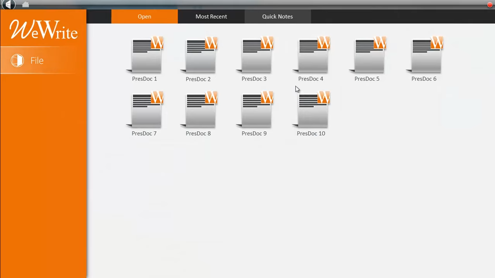
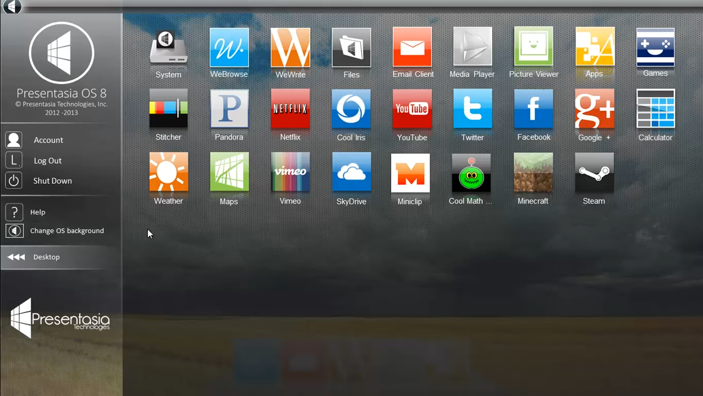
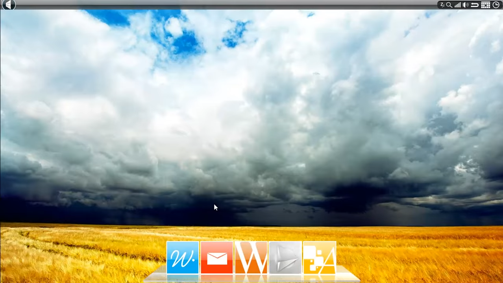
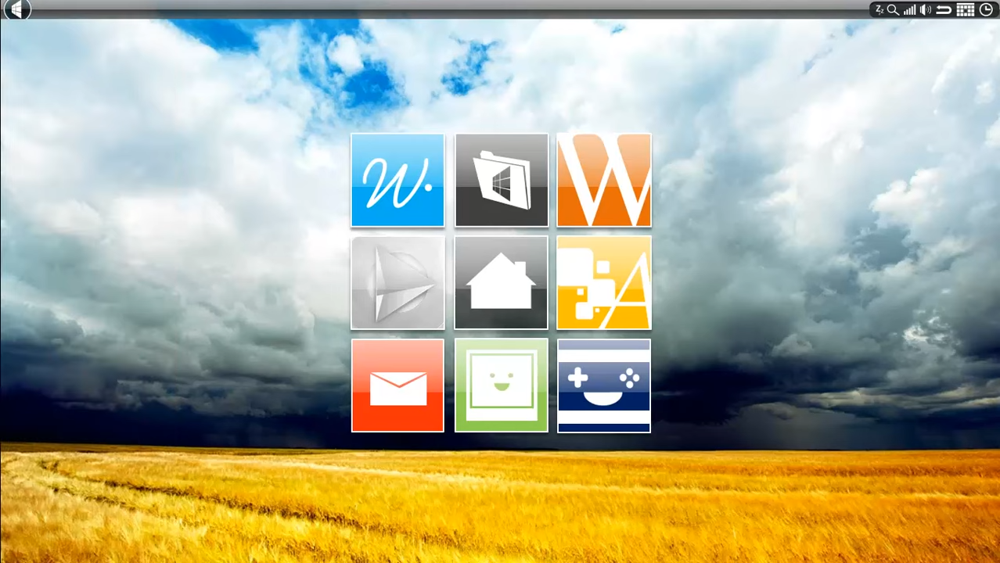
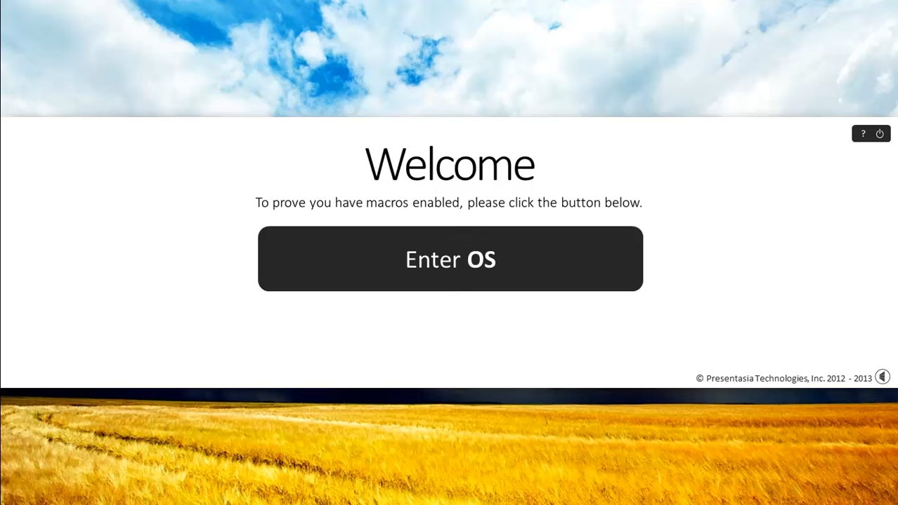

# Presentasia OS 8.0 Boundless

Presentasia OS 8.0 Boundless is the latest and most popular version of Presentasia OS with over 2,000 downloads. It reached 1,000 downloads on November 17, 2013.

## Applications and features

In this version, Calibri Light is the primary font, Mail and Writasia are replaced by WeMail and WeWrite, Calculator is replaced by WeCalculate, and the InfoTab is renamed the PresTab. Unlike prior text editors included with Presentasia OS, WeWrite requires the user to save their documents. The Start menu is opened from the taskbar.

## Desktop modes

This version highlights the return of FlatView mode (which was previously used from Presentasia OS 2-3) as a desktop mode. MatrixView is the default desktop mode. This version of Presentasia OS also features Smart Desktops, which remembers whether a program was opened from the MatrixView desktop, the FlatView desktop, or another menu.

## Macro checkpoint

Presentasia OS 8 was the first version of Presentasia OS to have the macro checkpoint upon startup to determine if macros are enabled (Press "Enter the OS" if you have macros enabled).

## Canceled update

An update to Presentasia OS 8.0 Boundless was teased on November 17, 2013, but it was canceled early on in development due to lack of third party support. This is confirmed by tweets Presentasia sent.
