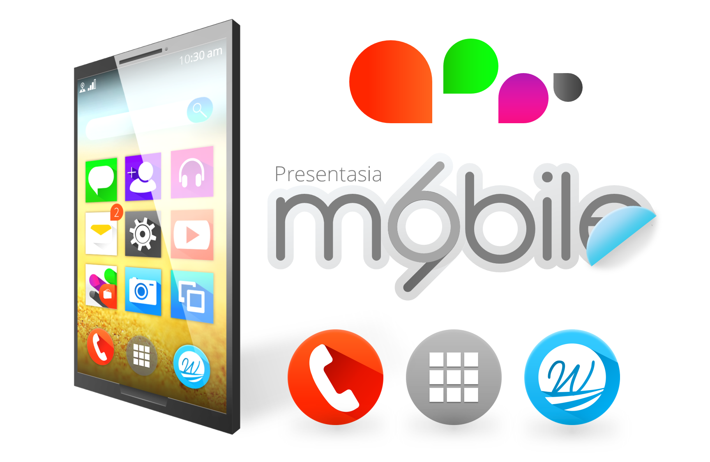
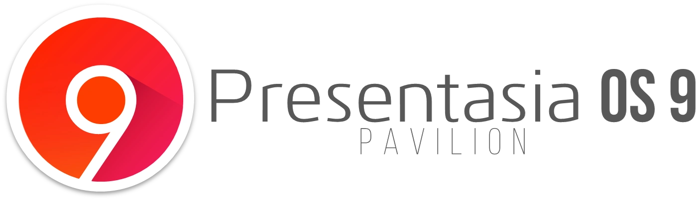

# Presentasia OS 9 Pavilion

Presentasia OS 9 Pavilion was a version of Presentasia OS that was never released. It was first teased on January 12, 2014, with a post reading "9 | #Nine". On June 24, 2014, Presentasia Technologies posted design concepts of Presentasia OS 9 Pavilion to the PowerPoint OS Network and other social media accounts. To this day, the
official website for Presentasia OS still shows a teaser of Presentasia OS 9 Pavilion.

## Development

Presentasia OS 9's development was supposed to come after Eminent's release, but Eminent was canceled, so OS 9's development started right away instead of waiting for Eminent's release. On June 24, 2014, Presentasia announced that Eminent was officially canceled and that Presentasia OS 9 had started development. According to Presentasia, Eminent's features were moved to OS 9, adding new features as well as replacing old ones. For example, WeWrite was replaced by Broadsheet Office, and offline integration might have been in OS 9.

## Design

Pavilion's UI was called Matrix UI. The name might have also been a reference to Presentasia OS 4.0 Matrix, which was released back in 2012. Matrix UI looked nothing like OS 4.0 Matrix, where OS 4.0 was based on a gray theme (Sleek Silver), while Matrix UI was more vibrant with colors and a stunning flat design. It seemed to be influenced by Apple iOS 7/8 (icons) and Windows 8 (notification style). The design of Matrix UI was taken directly from Presentasia's Mobile concept, which was posted on April 19, 2014.

In this version, Presentasia Technologies introduced long-shadow and flat icons. Open Sans was also scrapped in OS 9, replaced by other fonts. The layout from the previous Presentasia OSes still remained in OS 9. The author stated that Presentasia OS 9 was the most important version of the Presentasia OS family because there are 9 squares in its logo.

## Features

The design concepts showed these features for OS 9. They were concept features and might not have been final:

- Offline integration (previously in Eminent)
- New fonts, replacing Open Sans
- Same old UI with a vibrant new look
- Notification center
- Music app (from Eminent)
- Broadsheet (replacing WeWrite)
- YouTube app and other web apps
- Simple, flat design (Matrix UI)
- PowerPoint OS Network app (the first Presentasia OS to include one)

## Cancellation

On October 1, 2014, Presentasia canceled all of their projects, including OS 9. They also resigned from the PowerPoint OS Network and passed it to Midtown Technologies. The community was upset to see Presentasia leave the PowerPoint OS Network and stop making OSes.
