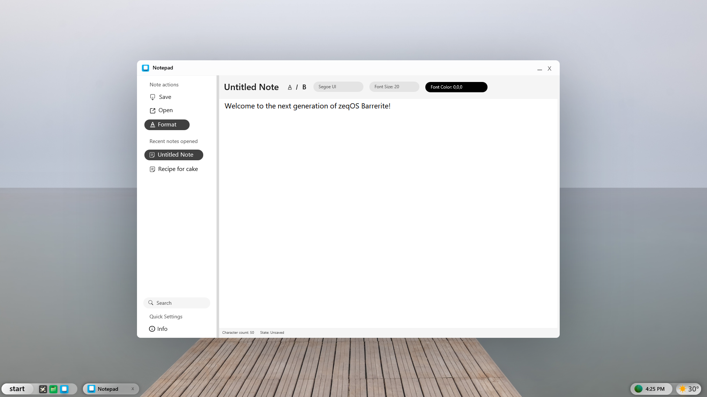
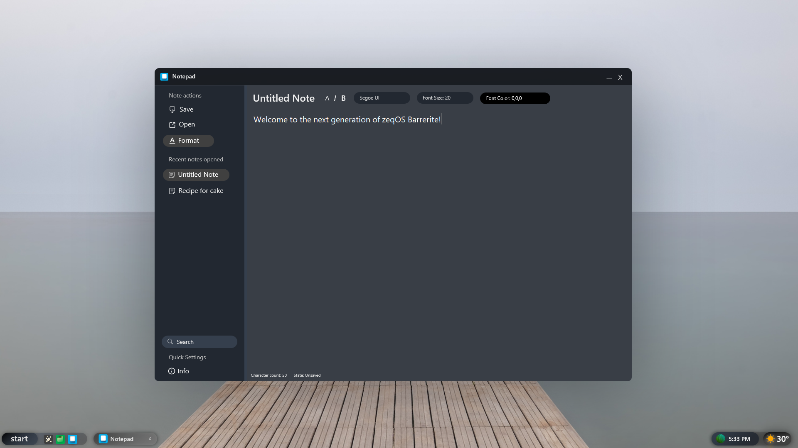
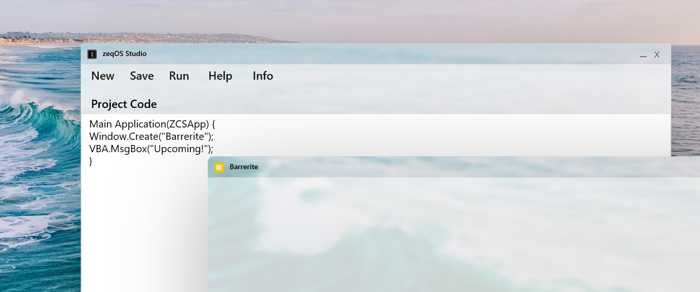

# zeqOS Barrerite

**zeqOS Barrerite** was a version of zeqOS with the ZT2 core (Zento 2). It was meant to replace [zeqOS Chabazite](/zeqOS/Chabazite/), but was never released.

## Overview

Barrerite had many different branches, and development went on for an unknown amount of time.

## Applications and features

Barrerite had a theming engine, which could change how applications looked. Notepad is one example: the same window in a light theme and a dark theme.





## Programming language

Barrerite had a new version of ZCS (zeqOS Coding Structure), the programming language used to make zeqOS apps, called ZCS 2. Apps are written in zeqOS Studio. The example below creates a window called "Barrerite" and shows a message box saying "Upcoming!".

```
Main Application(ZCSApp) {
Window.Create("Barrerite");
VBA.MsgBox("Upcoming!");
}
```



## See also

- [zeqOS](/zeqOS/)
- [All versions](/zeqOS/Versions/)
