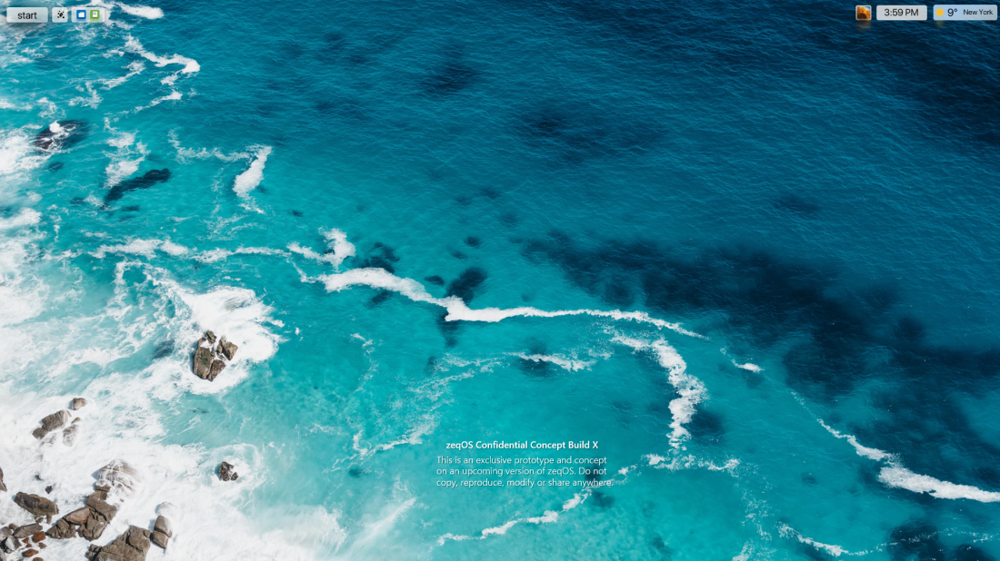
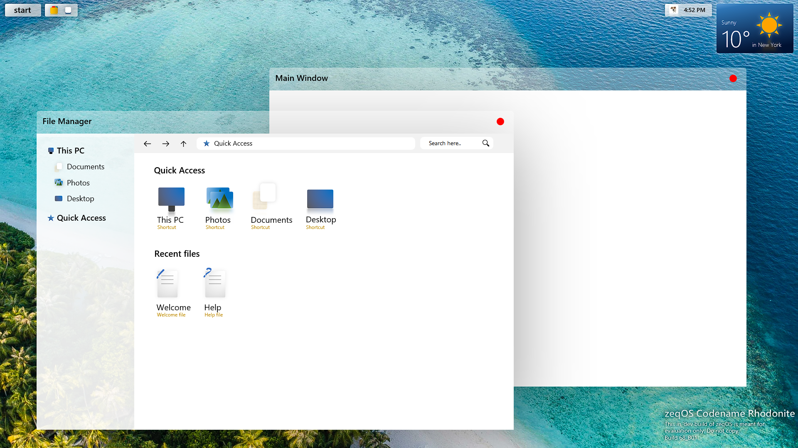
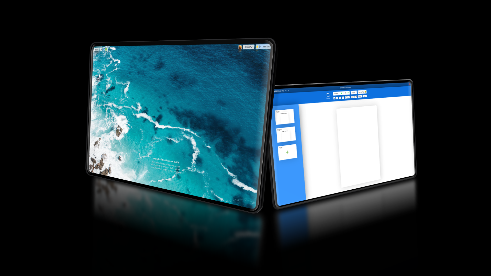

# zeqOS Chabazite

**zeqOS Chabazite** is the latest version of zeqOS, named after the mineral.

## Overview

Chabazite started as [zeqOS Rhodonite](/zeqOS/Rhodonite/), a version that was cancelled. In late 2020, development was reset to a new core called Zento (the previous core was NT).

Chabazite was released on July 17, 2021.

## Applications and features

Chabazite has a new File Manager and File System, and comes with Notepad, Bubbly (the virtual assistant), zeqOS Store, Calculator, Run, zeqOS Settings and zeqOS Update.

### Programming language

Chabazite was the first version of zeqOS to introduce ZCS, the zeqOS Coding Structure, the programming language used to make zeqOS apps. Apps written in ZCS are made in zeqOS Studio.

## Development cycle

Chabazite began development as Rhodonite. After Rhodonite was cancelled, development was reset to the new Zento core in late 2020. Beta builds from late 2020, shortly after the reset, still carried the old codename, labelled "zeqOS Codename Rhodonite", while others were labelled "zeqOS Confidential Concept Build X".

## Security issue

At launch, zeqOS Chabazite had a security issue. The only build affected was zeqOS_Chabazite_RTM3 (the first publicly available build).

## Support cycle

| Support phase | Includes | End date |
| --- | --- | --- |
| Full support | Update packs, small updates, etc. | August 20, 2021 |
| Mainstream support | Making it available to the public, downloads, updates, etc. | May 30, 2022 |
| Last-Time Support | Small bug fixes | January 1, 2023 |

## See also

- [zeqOS](/zeqOS/)
- [All versions](/zeqOS/Versions/)
