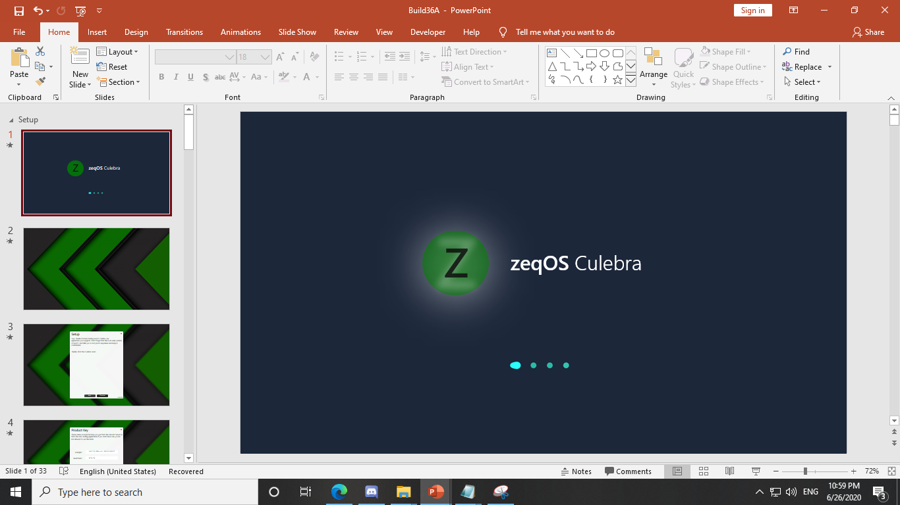

# zeqOS Culebra

**zeqOS Culebra** was a version of zeqOS sometime after the release of [zeqOS Makalu](/zeqOS/Makalu/). It was only ever used by beta testers.

## Overview

A screenshot of Culebra shows it in the PowerPoint window, not in slideshow mode, with 33 slides. Because it is multi-slide, it is assumed that Culebra lacked the moving window ability that [zeqOS Natrolite](/zeqOS/Natrolite/) had, though the setup UI appears to mimic the setup UI used from Natrolite onward.

## See also

- [zeqOS](/zeqOS/)
- [All versions](/zeqOS/Versions/)
