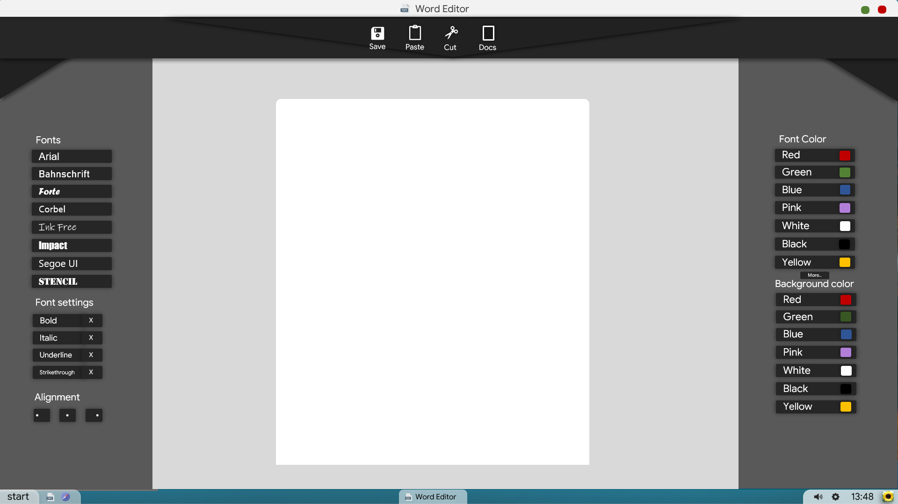
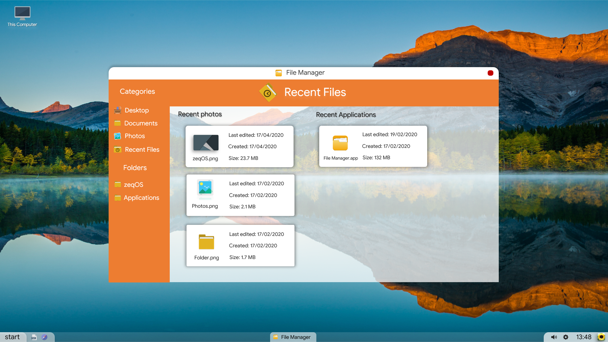

# zeqOS Makalu

**zeqOS Makalu** was the first version of zeqOS to be released to the public.

## Overview

Makalu was a multi-slide PPTOS, lacking the moving windows that [zeqOS Natrolite](/zeqOS/Natrolite/) later had.

## Applications and features

Makalu featured an account system, a file manager, a word editor, View&Play and an Internet browser.

## See also

- [zeqOS](/zeqOS/)
- [All versions](/zeqOS/Versions/)
