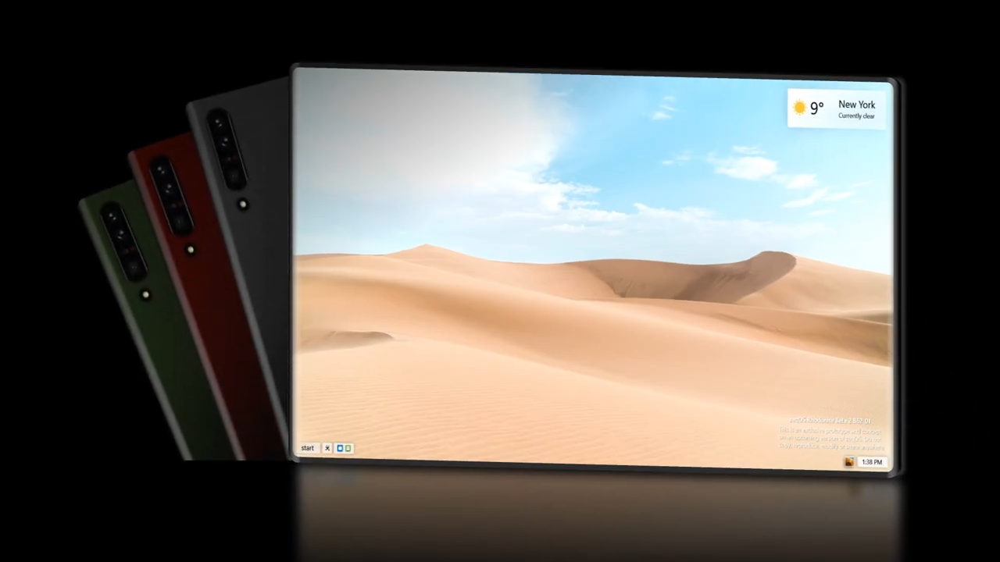
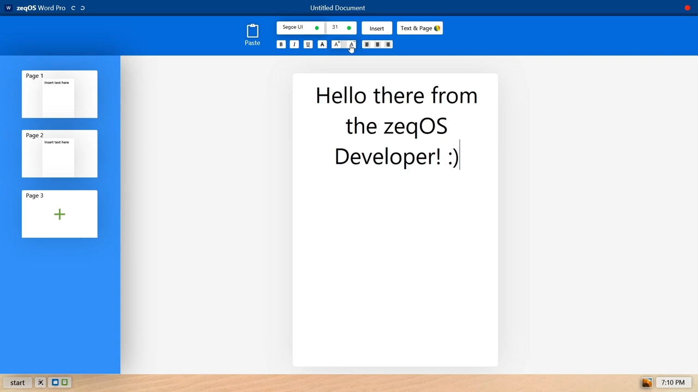
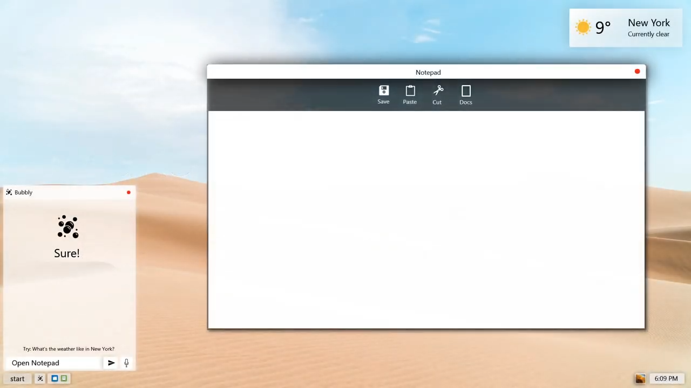

# zeqOS Rhodonite

**zeqOS Rhodonite** was a version of zeqOS that was cancelled. In late 2020, its development was reset to a new core called Zento, and it became [zeqOS Chabazite](/zeqOS/Chabazite/).

## Overview

Rhodonite was shown by Zulo in a video, "zeqOS Rhodonite PPTOS | Event Part 1", which premiered on November 8, 2020. The video showed a fully-functional PPTOS with a File System and movable windows.

## Applications

Rhodonite was very lightweight, appearing to only have around three applications pre-installed: the File Manager, Notepad, and zeqOS Word Pro. Bubbly, the built-in assistant, was first properly unveiled in Rhodonite.

## See also

- [zeqOS](/zeqOS/)
- [All versions](/zeqOS/Versions/)
